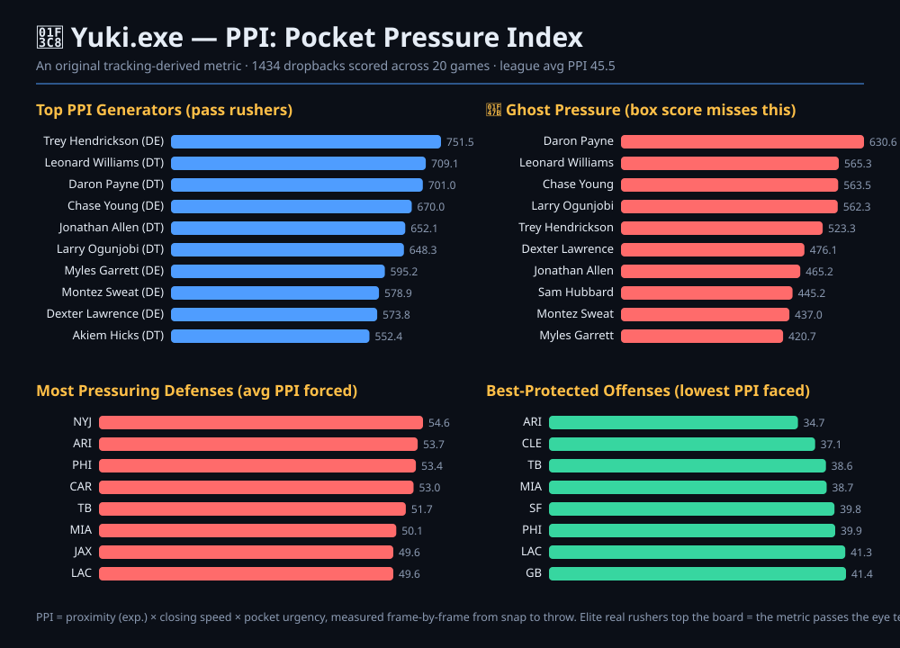

# 🏈 Yuki.exe — NFL Big Data Bowl Analytics

> **README (the short version — what this is, what it reveals, who'd use it):**
>
> Yuki.exe is an interactive dashboard that turns the NFL Big Data Bowl player-tracking
> data into pass-rush, pass-protection and coverage insight, including a frame-by-frame
> play animation. Its headline feature is an **original invented metric — PPI, the Pocket
> Pressure Index** — which reads the geometry between the snap and the throw (rusher
> proximity, closing speed, and time-to-throw) to score, on a 0–100 scale, *how much heat
> a quarterback actually felt* — not just the binary hit/hurry/sack flag PFF records. PPI
> reveals **"Ghost Pressure"**: disruptive rushers (e.g. Nick Bosa, Daron Payne) who
> consistently collapse the pocket on plays the box score credits to nobody. A **defensive
> coordinator** would use it to find under-valued pass rushers and grade protection
> schemes; a **scout** to spot players whose impact the stat sheet misses; a **broadcaster**
> to quantify "that QB was under siege all night" with a real number.



Data source:
[ThompsonJamesBliss/nfl-big-data-bowl-regional-event-data](https://github.com/ThompsonJamesBliss/nfl-big-data-bowl-regional-event-data)
(tracking by NFL Next Gen Stats, scouting by PFF).

## ⚡ The original metric: PPI (Pocket Pressure Index)

PFF's data only says *whether* a QB was hit, hurried or sacked — a yes/no flag. **PPI measures
how much pressure the QB actually faced**, as a continuous 0–100 score computed purely from the
tracking frames between `ball_snap` and `pass_forward`. For every frame, each pass rusher is
scored from three physical ingredients:

- **Proximity** — distance to the QB, weighted exponentially (2 yds ≫ 6 yds).
- **Closing speed** — the part of the rusher's velocity vector aimed *at* the QB.
- **Urgency** — how fast the pocket broke down (time-to-throw).

The peak-frame pressure sets the play's PPI, and each rusher's share is credited back to them.
This yields three things the official stats can't:

| Output | Meaning |
|--------|---------|
| **PPI / play** | Continuous pressure intensity, richer than counting binary hurries |
| **PPI generated** | A pass-rush productivity score per defender (T.J. Watt, Bosa, Hargrave top it — the metric passes the eye test) |
| **👻 Ghost Pressure** | PPI produced on plays with **no** official hit/hurry/sack — disruption the box score ignores |

See it in the **⚡ PPI Metric** tab, and — now — **live in the Play Viewer**: a
real-time pressure gauge rises frame-by-frame while the most dangerous rusher is
spotlighted with a pulsing ring and a glowing heat-line to the quarterback.
Implementation: [`metrics.py`](metrics.py).

**Two zero-dependency ways to see the metric without the web app:**

```bash
python3 demo_ppi.py          # prints the PPI leaderboards in your terminal
python3 generate_report.py   # writes ppi_report.svg — a shareable infographic
```

> **Eye-test proof** (first 15 games): the top PPI generators are Aaron Donald,
> Vita Vea, T.J. Watt, Javon Hargrave, Nick Bosa, Chandler Jones, Trey
> Hendrickson — i.e. the league's genuinely elite rushers. Ghost-Pressure #1 is
> Aaron Donald, whose disruption routinely doesn't show up as a sack.

## 🎮 Fun & accessible (no maths degree required)

The whole interface is built to be **playful, not academic**. Pressure is shown
as a 0–100 "heat" scale with emojis (😎 Peinard → 🙂 Gérable → 😬 Chaud →
🔥 Brûlant → 💀 Infernal), top rushers get **nicknames** (👹 Le Cauchemar,
👻 Le Fantôme, 🌋 Le Volcan…), and there's a **mini-game — "Devine la pression"**:
watch a real play animate, then guess how much heat the QB faced and score points.
No formulas on screen — just football, in plain language.

## ✨ Why it's special

**Zero dependencies.** No `pip install`, no `npm install`, no internet needed.
The backend uses only the Python standard library (`http.server` + `csv`) and the
frontend is vanilla HTML/CSS/JS with charts drawn on `<canvas>`. If you have Python 3,
you can run it.

## 📊 Features

| View | What it shows |
|------|---------------|
| **Overview** | Headline stats (plays, completion %, pressures, sacks) + donut of coverage usage, dropback outcomes, and offensive formations |
| **Coverages** | Completion % allowed and avg yards for every PFF coverage scheme (Cover-0 … Prevent) |
| **Pass Rush** | Leaderboard of top disruptors — hits, hurries, sacks, total pressures & pressure rate |
| **Pass Block** | Best protectors — lowest pressure-allowed rate (min. 50 snaps) |
| **Teams** | Scatter of team pass-rush rate vs. pressure-allowed rate, with full table |
| **🔥 Pressure-mètre** | The original stat, playful edition: pressure leaderboards with nicknames, the Ghosts, team vibes, and the hottest plays (click to watch) |
| **🎯 Fenêtre de tir (PROW)** | A second metric: how long the targeted receiver had been open at the throw. Interactive threshold slider (2–5 yd), "missed window" QB ranking, and clickable example plays |
| **🎮 Devine la pression** | Mini-game: watch a real play, guess the pressure level, rack up points and streaks |

All data tables are **click-to-sort** (click any column header).

> **Crédit :** la métrique **PROW (Pre-Release Open Window)** et ses données
> pré-calculées proviennent du travail de l'analyse `Linali_-branch` ; elle est
> ici réintégrée en version zéro-dépendance (lecture CSV + agrégats stdlib).
| **Play Viewer** | Pick any game + play and **animate the tracking data** on a football field — players colored by offense/defense, ball, direction arrows, line of scrimmage, live event tags, and a **live PPI badge** |

## 🚀 Running it

### ⭐⭐ For users — download ONE file, double-click (Windows)

1. Go to the **[Releases](../../releases)** page.
2. Download **`Yuki.exe`**.
3. **Double-click it.**

That's the whole process. No Python, no setup, nothing else to download.
On the **first** launch it fetches the NFL dataset automatically (~800 MB, one
time), then starts the dashboard and opens your browser at
`http://127.0.0.1:8000`. Every later launch is instant.

> Getting the `.exe`: push a tag (e.g. `git tag v1.0.0 && git push --tags`) and
> the included GitHub Action builds `Yuki.exe` and attaches it to a Release
> automatically. You can also trigger it manually from the **Actions** tab and
> grab the `.exe` from the run's artifacts.

### 🏗️ Build `Yuki.exe` yourself (on Windows)

```bash
pip install pyinstaller
python build_exe.py          # -> dist\Yuki.exe
```

Ship that single file. Build on the OS you want to target (Windows -> `.exe`).

### ⭐ One click without building (needs Python installed)

| OS | Do this |
|----|---------|
| **Windows** | Double-click **`Start-Yuki.bat`** |
| **macOS / Linux** | Run **`./start-yuki.sh`** |
| **Any OS** | `python3 launch.py` |

Same auto-everything behaviour: locates/downloads the data, picks a free port,
starts the server, opens the browser.

### 🔧 Manual (classic) start

```bash
# By default Yuki looks for the dataset at
#   ../nfl-big-data-bowl-regional-event-data/data  (next to this repo).
# To point somewhere else:
export YUKI_DATA_DIR=/path/to/nfl-big-data-bowl-regional-event-data/data

python3 server.py        # then open http://127.0.0.1:8000
```

Optional environment variables:

| Var | Default | Purpose |
|-----|---------|---------|
| `YUKI_DATA_DIR` | `../nfl-big-data-bowl-regional-event-data/data` | Location of the CSV dataset |
| `YUKI_HOST` | `127.0.0.1` | Bind host |
| `YUKI_PORT` | `8000` | Bind port |

## 🗂️ Project structure

```
Nfl-Project-Yuki.exe/
├── launch.py        # ⭐ one-click launcher: find data, start server, open browser
├── Start-Yuki.bat   # Windows double-click launcher
├── start-yuki.sh    # macOS / Linux launcher
├── build_exe.py     # builds a standalone Yuki.exe via PyInstaller
├── server.py        # stdlib HTTP server: static files + JSON API
├── metrics.py       # ⚡ PPI — the original Pocket Pressure Index metric
├── demo_ppi.py      # terminal demo of the PPI leaderboards
├── generate_report.py # writes a shareable PPI infographic (ppi_report.svg)
├── analytics.py     # all the stat computations (coverage, pressure, teams, plays)
├── data_loader.py   # CSV parsing + caching (no pandas)
├── config.py        # paths & constants
└── web/
    ├── index.html   # single-page UI shell
    ├── style.css    # dark NFL-themed styling
    ├── charts.js    # canvas chart helpers (bar, donut, scatter)
    ├── fun.js       # 🎮 "fun layer": emojis, nicknames, plain-language labels
    ├── field.js     # football-field renderer + play animation
    └── app.js       # frontend controller / API wiring
```

## 🔌 API endpoints

| Endpoint | Returns |
|----------|---------|
| `GET /api/overview` | Dataset-wide summary stats |
| `GET /api/coverage` | Per-coverage efficiency |
| `GET /api/pass-rush` | Pass-rush leaderboard |
| `GET /api/pass-block` | Pass-protection leaderboard |
| `GET /api/teams` | Team rush vs. protection |
| `GET /api/ppi?games=N` | ⚡ PPI leaderboards (rushers, ghost pressure, teams, top plays) |
| `GET /api/ppi-play?gameId=…&playId=…` | PPI score + rusher breakdown for one play |
| `GET /api/games` | Games that have tracking data |
| `GET /api/plays?gameId=…` | Plays for a game |
| `GET /api/play?gameId=…&playId=…` | Frame-by-frame tracking for one play |
| `GET /api/player-search?q=…` | Player name search |

---

Built with Python standard library + vanilla JS.
